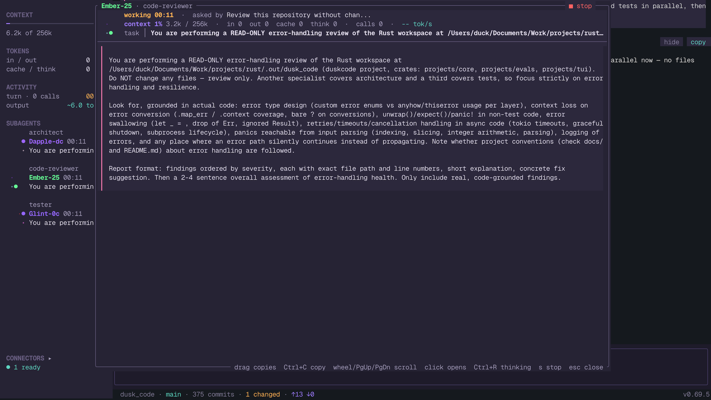
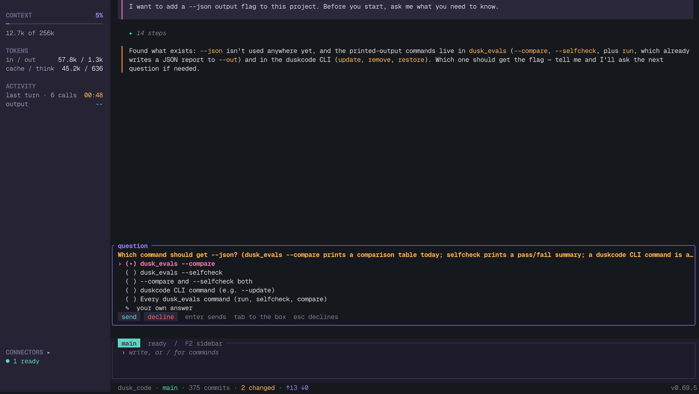
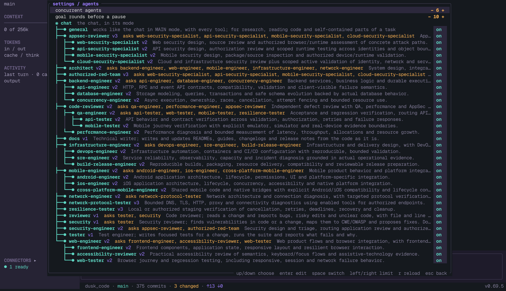

# duskcode

duskcode is a coding agent that works in your terminal. You describe a task in a
project folder; the agent reads the code, runs commands, edits files and asks you when
something it cannot find out would change the result. When a task is large, it hands
parts of it to specialist agents that work in parallel, and you can watch each of them.

It is written in Rust, talks to any OpenAI-compatible model API, local servers included,
and keeps its sessions in a local database, so a crash or a restart loses nothing.
MIT licensed, for Linux and macOS.

<p align="center">
  
</p>

## Install

```sh
curl -fsSL https://raw.githubusercontent.com/DroBov1Tya/dusk_code/main/install.sh | sh
```

The installer downloads a release build for macOS arm64 or Linux x86_64 / arm64,
checks its checksum and links `duskcode` into `/usr/local/bin`, or `~/.local/bin` when
that is not writable. Then, in a project folder:

```sh
duskcode
```

On first start, `/connect` adds a provider (an API base URL and key) and `/model`
picks the model. `/update` installs a newer release; the stable channel follows full
releases, the dev channel pre-releases too.

To build from source: `cargo build --release`, which produces `target/release/duskcode`.

## What it is

**One agent you talk to, a team behind it.** The chat runs in a mode: MAIN does the work
itself, ORCHESTRATOR plans and delegates, PLAN only plans. Thirty-two specialist agents
ship with it, from an architect and a code reviewer to security and mobile engineers.
Each is a Markdown file with its instructions, the tools it may use and the agents it
may ask in turn. Edit them, add your own, or switch them off.



**It asks instead of guessing.** When an answer would change the result and cannot be
found in the code, the agent asks a question with options, its recommendation first.
You pick one, write your own answer, or decline; the work goes on from there.



**Work you can follow.** Thinking and tool calls fold into short rows. The rail on the
left shows context use, tokens, running agents and connected MCP servers. Long commands
can run in the background while the conversation continues; `/jobs` shows their output.
A task board keeps the steps of longer work with their timings, and `/goal` holds a goal
with acceptance criteria the agent must show evidence for.


**Plain files you own.** Configuration is one YAML file; agents, skills, modes and
prompts are Markdown under `~/.config/duskcode/rules/`. Everything changed in
`/settings` is written back there, so the setup can be read, diffed and copied.
`/migrate` packs config and chats into one archive for another machine.



## Under the hood

```text
             duskcode TUI
                  │
             dusk_core
                  │
    ┌─────────────┼──────────────┐
    │             │              │
 providers    agent runtime   local state
    │         and tools       and config
 model APIs   shell / MCP     SQLite / YAML
```

| Component | Responsibility |
| --- | --- |
| `projects/core` | Config, providers, agents, tools, runtime and state; no terminal code |
| `projects/tui` | The terminal client: drawing, input, navigation and images |
| `projects/evals` | Benchmark tasks that check whether a prompt or tool change helps |
| `resources/` | The shipped modes, agents and skills, installed beside the binary |

Every tool call is checked against the tool's JSON Schema before it runs, so a malformed
call comes back to the model as an error it can correct. Messages, turns and tool
results are written to SQLite as they happen; a turn cut short by a crash is marked
interrupted and the thread goes on from there. Context is compacted before it reaches
the limit, which follows the model's window when the provider reports one, or the number
you set.

## Files and configuration

| Location | Contents |
| --- | --- |
| `~/.config/duskcode/config.yml` | Providers, model, limits, tools, agents, skills, MCP servers, appearance, logging |
| `~/.config/duskcode/rules/` | Agents, skills, modes, prompts and the user memory |
| `~/.config/duskcode/session/` | The session database |
| `~/.config/duskcode/logs/` | `core.log` and `tui.log`; `DUSKCODE_LOG` sets the level |
| `~/.config/duskcode/mcp-auth/` | OAuth tokens of the MCP servers signed in to |
| `~/Documents/duskcode/` | One folder per chat for its sources and files |
| `~/.local/share/duskcode/` | The installed binary and its resources |

`DUSKCODE_GRAPHICS=kitty|iterm2|sixel` overrides the detected image protocol.
`duskcode remove` uninstalls, after asking.

## Network and privacy

duskcode has no telemetry. It talks to the model providers and MCP servers you
configure, to GitHub when it checks for updates, and to an image host when asked to show
a remote image. What a provider does with your requests is set by that provider.

Logs stay on disk. To trace turns, model calls and tool calls in your own OpenTelemetry
collector, name it in the config; spans carry names, IDs, counts and times, not message
text:

```yaml
logging:
  traces:
    endpoint: http://127.0.0.1:4318   # OTLP/HTTP; spans go to /v1/traces
    headers: {}                       # such as a collector's API key
```

`logging.enabled: false`, or the logs switch in /settings, writes and sends nothing.

## Limitations

- It is pre-1.0: commands, config keys and the database still change between releases,
  with migrations for the database.
- `run_command` runs any shell command with your permissions once you allow it, or
  without asking in Full access. It is not a sandbox; run duskcode where that is
  acceptable.
- Providers are OpenAI-compatible Chat Completions APIs and the Anthropic Messages API.
- No Windows build. Themes and key bindings are fixed.
- Pictures need a terminal with kitty, iTerm2 or sixel graphics; others get a preview
  drawn in characters.

## License

[MIT](LICENSE). Bundled skills keep their own licenses; see
[resources/skills/NOTICE.md](resources/skills/NOTICE.md).
