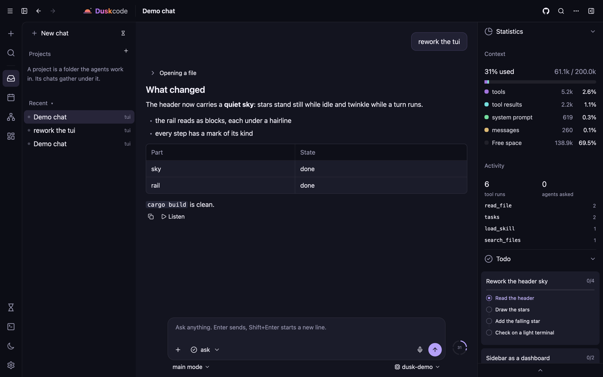
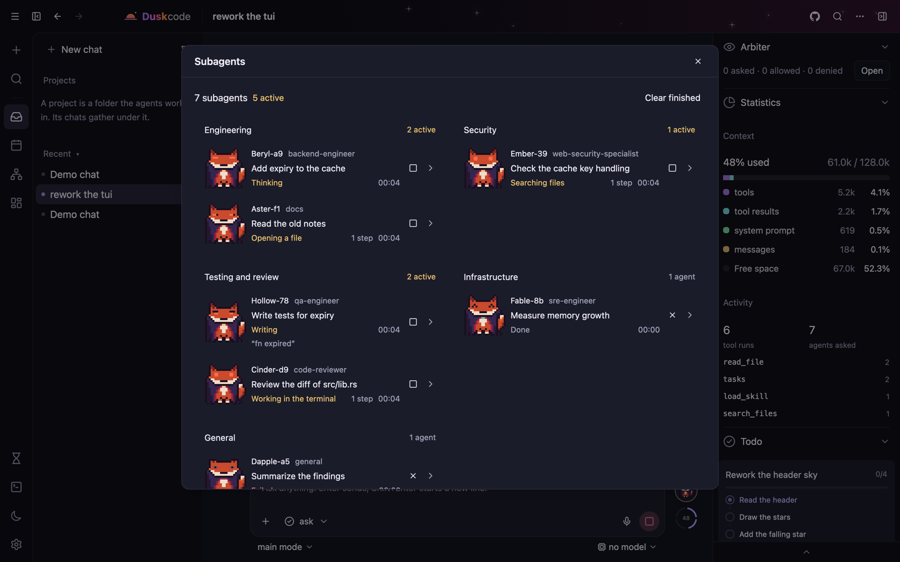
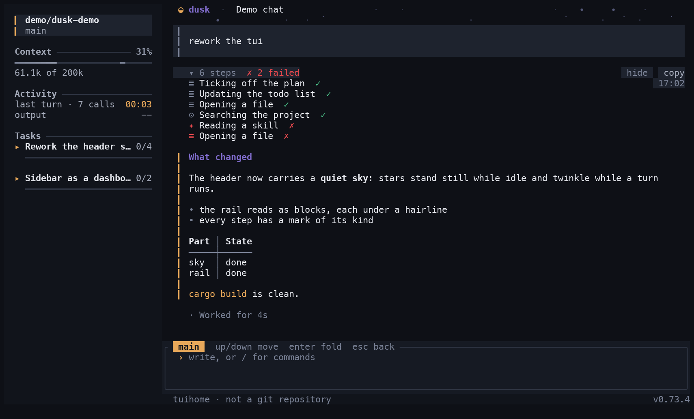
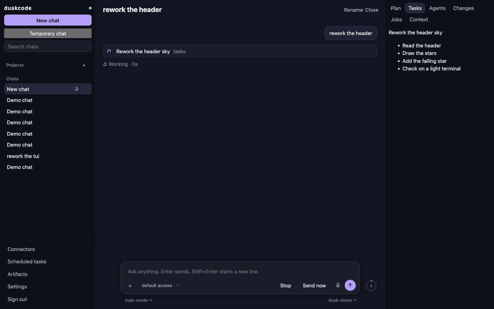

# duskcode

An open-source coding agent in Rust: one core, three clients. It reads and edits your
project, runs commands, hands work to specialist agents, and keeps everything it knows on
your machine.

<p align="center">
  
</p>

- **One core, thin clients.** The desktop window, the terminal client and the web client
  draw the same threads over one protocol. A feature lands in the core once.
- **Any model you can reach.** OpenAI, Anthropic, Google, any OpenAI-compatible server,
  local models, or your ChatGPT plan with no API key.
- **Local by default.** No account, no telemetry, no project servers. Chats are a SQLite
  file, secrets are in the system keychain.
- **Readable.** MIT, about one binary per client, agents and skills as Markdown you can edit.

## The clients

| Desktop | Terminal | Web |
| --- | --- | --- |
|  |  |  |
| `duskcode-gui`: chats and projects, a file viewer and editor, your own terminal in a panel, subagents and the arbiter in windows of their own. macOS and Linux. | `duskcode`: full screen in any terminal, 24-bit colour, keyboard and mouse. Runs on a server over SSH. | `duskcode --web`: the same chats in a browser, served by the core. `--global` opens it to other devices on your network. |

## Install

```sh
curl -fsSL https://raw.githubusercontent.com/DroBov1Tya/dusk_code/main/install.sh | sh
```

The installer asks what to install: the terminal client, the desktop client, or both.
`DUSKCODE_INSTALL=tui`, `gui` or `both` answers ahead, for a server or a script. It
downloads a release build for macOS arm64 or Linux x86_64 / arm64 and checks it against
the digest GitHub keeps for the release.

Then, from a project folder:

```sh
duskcode
```

`/update` installs a newer release; `duskcode remove` uninstalls and asks first.

## Connect a model

`/connect` in the terminal, or Settings, Model in the desktop window.

| How | What it needs |
| --- | --- |
| **Sign in with ChatGPT** | A ChatGPT plan. No API key. |
| OpenAI, Anthropic, Google AI | An API key from the provider's console. |
| Custom | The address of any server that speaks the OpenAI Chat Completions API, and its key if it has one. |
| Local | Ollama, LM Studio, vLLM and the like on `http://localhost`; nothing leaves the machine. |

Several providers can be connected at once; `/model` lists the models of each.

### Sign in with ChatGPT

OpenAI offers this to open-source and locally run apps, and duskcode uses it as
documented:

1. duskcode starts a listener on `127.0.0.1` and opens OpenAI's sign-in page in your
   browser. You sign in there; duskcode never sees your password.
2. OpenAI issues this install a client ID of its own and sends the browser back to the
   listener with a one-time code (authorization code with PKCE; there is no client secret).
3. duskcode exchanges the code for tokens and checks the identity token: its signature
   against OpenAI's published keys, its issuer, audience, expiry and nonce. It also
   checks that use of the plan was granted.
4. Requests go to OpenAI's Responses API with `store: false`, so the conversation is
   not kept there. Usage counts against your plan; you can cap it per app at
   [chatgpt.com/settings/usage](https://chatgpt.com/settings/usage).

The sign-in record is kept where API keys are kept, in the system keychain. It works
only with `api.openai.com`, and removing the provider forgets it.

A Claude subscription cannot be used this way: Anthropic allows signing in with a Claude
account only in its own apps. Claude models work here with an API key.

## What it does

- **Modes**: MAIN for direct work, ORCHESTRATOR to delegate, PLAN to plan first; your own
  modes are Markdown files.
- **Tools**: read, search and edit files, run commands in the foreground or as background
  jobs, look at pictures, and on a desktop see the screen and use the mouse and keyboard.
- **Subagents**: specialist agents by role, several at once, each in its own thread. An
  arbiter can answer their approval requests under rules you set.
- **Approvals**: ask, sandbox, arbiter or full access, per chat. A command that needs an
  approval nobody can give is denied.
- **Skills, MCP servers and plugins**: skills are loaded when a task needs them; MCP
  servers add tools, with OAuth where the server asks; plugins bring skills, agents,
  providers, hooks and platforms such as the built-in Telegram bot
  ([docs/plugins.md](docs/plugins.md)).
- **Memory you can read**: notes per project and about you, as plain files. A temporary
  chat is kept in memory only and leaves nothing on disk.
- **Long work**: task lists, goals with acceptance criteria (`/goal`), scheduled runs,
  context compaction (`/compact`), forks from a summary (`/fork`), undo to an earlier
  message.
- **Voice**: dictation and reading aloud through servers you connect or models
  installed on the machine.
- **Headless**: `duskcode run "prompt"` prints the answer; `--json` adds the usage.

## How it is built

```text
 duskcode-gui     duskcode (terminal)     browser
       \                 |                   /
        +--------- dusk_protocol -----------+
                         |
                     dusk_core
        providers · agents · tools · MCP · plugins
        threads in SQLite · secrets in the keychain
```

| Crate | Responsibility |
| --- | --- |
| `projects/protocol` | Requests, responses, events and status every client shares |
| `projects/core` | All logic and state: providers, runtime, tools, agents, config |
| `projects/server` | The way into the core from outside its process: the web server today |
| `projects/clients/terminal`, `desktop`, `browser` | What a person sees: they draw and call the core; the browser page is Leptos, WebAssembly |
| `projects/evals` | Tasks that measure the engine, and their runner |
| `resources/` | Shipped modes, agents, skills, plugins and prompts |

[docs/structure.md](docs/structure.md) says where a file goes;
[docs/agent-engine.md](docs/agent-engine.md) describes a turn.

## Security and privacy

- **Secrets live in the system keychain** (macOS Keychain, Secret Service on Linux), in
  one item. They are never written to `config.yml`, logs, chat history or backups, never
  shown in the interface and never sent to a model. Without a keychain they stay in the
  private config file.
- **Nothing phones home.** The program talks to the providers, voice servers and MCP
  servers you configure, and to GitHub to look for a newer release; that request carries
  no chat data. Tracing is off unless you set an endpoint.
- **Files and git only inside saved projects.** Paths are canonicalized; `..` and
  symlinks that lead out are refused.
- **Model output is data.** It is drawn as Markdown, links open only as http(s), and
  what a file, a page or a tool says is never taken as an instruction to the program.
- **The web client** binds to this machine unless you ask otherwise, signs in with a
  token of the run, checks `Host` and `Origin` on every request, and says plainly that
  the traffic is not encrypted when opened to a network.
- **Shell commands run with your permissions.** Approvals control what is asked first;
  the sandbox mode restricts commands where the system offers a sandbox.

Report a vulnerability as [SECURITY.md](SECURITY.md) says.

## Configuration and data

| Location | Contents |
| --- | --- |
| `~/.config/duskcode/config.yml` | Providers, model, limits, tools, agents, skills, MCP servers, logging |
| `~/.config/duskcode/rules/` | Agents, skills, modes, prompts, plugins and memory, as Markdown |
| `~/.config/duskcode/session/` | The chat database and artifacts |
| `~/.config/duskcode/logs/` | Logs; `logging.enabled: false` switches them off |
| `~/Documents/duskcode/` | Chat workspaces; `projects/` holds project memory |
| `~/.local/share/duskcode/` | The installed program and its resources |

## Build from source

```sh
cargo build --release                 # the terminal client
cargo build --release -p dusk_gui     # the desktop client; needs a recent stable Rust
scripts/build-web.sh                  # the web page, embedded by the next build
```

`Cargo.lock` is committed, so a build uses the dependency versions of a release.
[CONTRIBUTING.md](CONTRIBUTING.md) has the rules of the code.

## Limitations

- Pre-1.0: commands, configuration and the database schema may change. Patch versions
  are pre-releases.
- Release builds are for macOS arm64 and Linux; there is no Windows build.
- The macOS app is signed with the project's own certificate, not an Apple Developer
  ID, so the first start needs your confirmation.
- What a model can do depends on the model. Requests to external providers and MCP
  servers fall under their data policies.

## Support

duskcode is free and has no paid tier. If it saves you time and you want to say thanks:

- Bitcoin: `bc1q636n7dg4kwjqn0tm4v5vlxfwzydqgte4423xkz`
- Litecoin: `ltc1q0xdfq0ze6f2cqdufgnnm3p3fls5km9qvjj2vkd`

Issues and pull requests help as much.

## License

[MIT](LICENSE).
