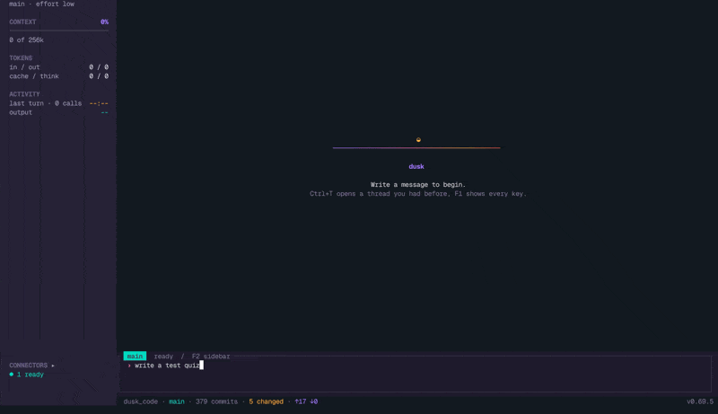
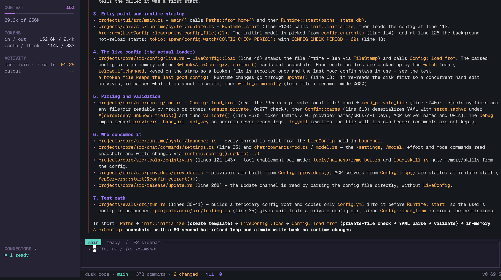

# duskcode

duskcode is a terminal coding agent written in Rust. It connects to model APIs and
provides tools for reading and editing project files, running shell commands, and
delegating tasks to specialist agents. Sessions are stored locally in SQLite.

## Install

```sh
curl -fsSL https://raw.githubusercontent.com/DroBov1Tya/dusk_code/main/install.sh | sh
```

The installer asks what to install: the terminal client `duskcode`, the desktop
client `duskcode-gui`, or both. `DUSKCODE_INSTALL=tui`, `gui` or `both` answers ahead,
for a server or a script:

```sh
curl -fsSL https://raw.githubusercontent.com/DroBov1Tya/dusk_code/main/install.sh | DUSKCODE_INSTALL=tui sh
```

Each part has its own script, which finds an existing install and updates it in place:

- `scripts/install-tui.sh` downloads a release build for macOS arm64 or Linux
  x86_64 / arm64, verifies its checksum, and links `duskcode` into `/usr/local/bin`
  or `~/.local/bin`.
- `scripts/install-gui.sh` builds the desktop client from a checkout (or downloads
  it once releases carry it), puts it beside `duskcode`, and adds `Duskcode.app` to
  `~/Applications` on macOS or a desktop entry on Linux. The build needs a recent
  Rust: `rustup update stable`.

Run the terminal client from a project folder:

```sh
duskcode
```

Use `/connect` to configure a provider and `/model` to select a model. The supported
protocols are OpenAI-compatible Chat Completions and Anthropic Messages.

To build from source:

```sh
cargo build --release
./target/release/duskcode
```

The desktop client is a separate binary, so a server never builds it:

```sh
cargo build --release -p dusk_gui
./target/release/duskcode-gui
```

<p align="center">
  
</p>

## Features

- MAIN, ORCHESTRATOR, and PLAN modes for direct work, delegation, and planning.
- Specialist agent definitions, skills, modes, and prompts stored as editable Markdown.
- MCP server connections and configurable tools and agents through `/settings`.
- Plugins that bring skills, agents, MCP tools, providers, hooks and platforms such
  as the built-in Telegram bot, found at runtime and switched on in `/plugins`; see
  [docs/plugins.md](docs/plugins.md).
- A transcript of responses, reasoning, and tool calls, with context and token usage.
- Background shell commands with status and output in `/jobs`.
- Task tracking, plus goals with acceptance criteria through `/goal`.
- Saved chats through `/resume`, context summaries through `/compact`, and new threads
  from a summary through `/fork`.
- Configuration and chat export through `/migrate`; archives include API keys.
- Headless runs: `duskcode run "prompt"` prints the answer (`--json` adds the usage,
  `--access`, `--project`, `--timeout`, `-` reads the prompt from stdin); progress goes to
  stderr, an approval nobody can give is denied.
- Release updates through `/update`, with stable and dev channels.



## Architecture

```text
duskcode TUI
     │
 dusk_core
     ├── Model providers: OpenAI-compatible / Anthropic
     ├── Agent runtime and tools: files / shell / MCP
     ├── Plugins: skills / agents / MCP / providers / hooks / platforms
     └── Local state and configuration: SQLite / YAML / Markdown
```

| Component | Responsibility |
| --- | --- |
| `projects/core` | Configuration, providers, agents, tools, runtime, and state |
| `projects/tui` | Terminal interface, input, navigation, and images |
| `projects/external/telegram` | The Telegram bot of the built-in `telegram` plugin |
| `projects/evals` | Evaluation runner for coding tasks |
| `resources/` | Bundled modes, agents, skills, plugins, and prompts |

## Configuration and data

| Location | Contents |
| --- | --- |
| `~/.config/duskcode/config.yml` | Providers, model, limits, tools, agents, skills, MCP servers, appearance, and logging |
| `~/.config/duskcode/rules/` | Agents, skills, modes, prompts, plugins, and user memory |
| `~/.config/duskcode/plugin-data/` | What plugins keep, such as a paired Telegram owner |
| `~/.config/duskcode/session/` | Session database and artifacts |
| `~/.config/duskcode/logs/` | Application logs |
| `~/.config/duskcode/mcp-auth/` | MCP OAuth tokens |
| `~/Documents/duskcode/` | Chat workspaces and files; `projects/` holds project memory |
| `~/.local/share/duskcode/` | Default installation directory; the installer also supports `XDG_DATA_HOME` |

`DUSKCODE_LOG` sets the log level. Logging can be disabled with `logging.enabled: false`;
optional OpenTelemetry tracing is configured under `logging.traces`.
`DUSKCODE_GRAPHICS=kitty|iterm2|sixel` selects a terminal image protocol.
`duskcode remove` starts the interactive uninstaller.

## Secrets, privacy, and trust

Everything stays on your machine unless you point it elsewhere.

- **API keys and tokens live in the system keychain** (macOS Keychain, Secret Service on
  Linux), in one item named `vault` under the service `duskcode`. They are never written to
  `config.yml`, logs, chat history, or backups, and they are not shown in the interface or
  sent to a model. Keys found in an older `config.yml` move into the keychain on first start.
  The same goes for the Hugging Face token and the voice (speech-to-text, text-to-speech)
  keys. MCP OAuth tokens are kept locally in `~/.config/duskcode/mcp-auth/`.
- **No project servers.** There is no account, no analytics, and no telemetry. The program
  talks only to the model providers, voice servers, and MCP servers you configure, and to
  GitHub to look for a newer release (the request carries no chat data). Local servers work:
  point a provider at `http://localhost:...` and nothing leaves the machine. Tracing
  (`logging.traces`) is off unless you set an endpoint yourself.
- **Chats, memory, and artifacts are local files**: a SQLite database under
  `~/.config/duskcode/session/` and workspaces under `~/Documents/duskcode/`. `duskcode remove`
  deletes them, together with the keychain item.
- **The code is fully open (MIT).** Anyone can download it, read it, and check these claims.
  If you do not trust the release binaries on GitHub, build from source as shown under
  [Install](#install) (`cargo build --release`, plus `-p dusk_gui` for the desktop client),
  change what you like, and run your own build. `Cargo.lock` is committed, so a build uses
  the same dependency versions as a release.

## Limitations

- The project is pre-1.0; commands, configuration, and database schema may change.
- Shell commands run with the user's permissions. The approval setting controls
  confirmation prompts; it does not provide an operating-system sandbox.
- Model behavior and API compatibility depend on the configured provider and model.
  Requests sent to external providers and MCP servers are subject to their data policies.
- Release builds target Linux and macOS; there is no Windows build.
- Image display depends on terminal graphics support, with a character preview fallback.

## License

[MIT](LICENSE). Bundled skills retain their own licenses; see
[resources/skills/NOTICE.md](resources/skills/NOTICE.md).
